# Hai no Majutsushi — traducción al inglés y tutorial

*[English](README.md)*

牌の魔術師 (*Hai no Majutsushi - Mahjong 2*; Konami, 1989, RC-765) es un mahjong para MSX2 con todos sus menús y mensajes en japonés. Este parche pone **en inglés todo lo que hay que leer para jugar** —los menús, las pantallas de reglas y de estilo, los nombres de los rivales, los menús de llamada, los yaku y los puntos, los avisos de fin de mano y los rótulos rojos PON! / CHI! / KAN! / RON! / TSUMO! / RIICHI!— y añade un **tutorial** con **F1** en el primer menú: nueve pantallas sobre las fichas, el objetivo, las combinaciones, las llamadas, el riichi y el tsumo, los menús y las teclas de la música.

**15.508** bytes cambiados · IPS de **15.936** bytes · 144 letras nuevas, 35 tiles pequeños nuevos, 6 rótulos nuevos · no se distribuye ninguna ROM


| Japonés | Inglés |
|---|---|
| 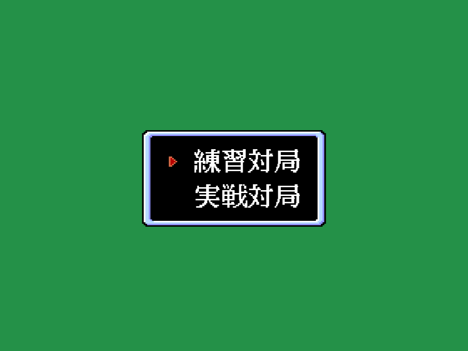 | 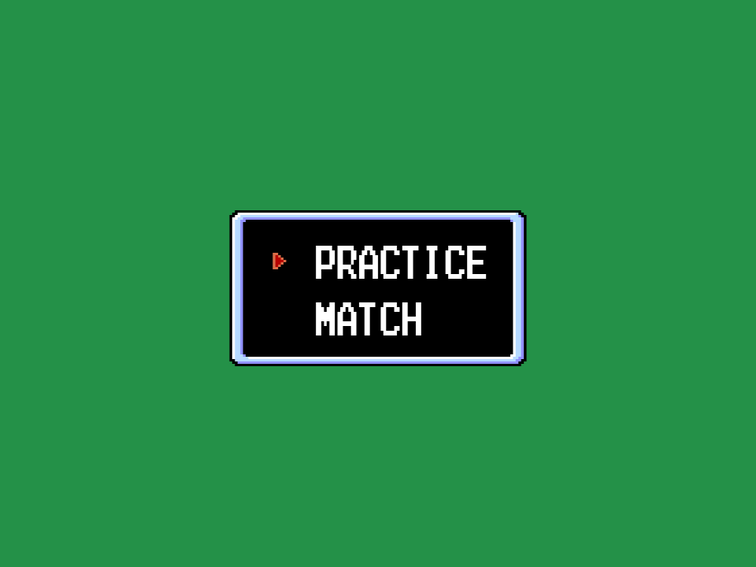 |
| 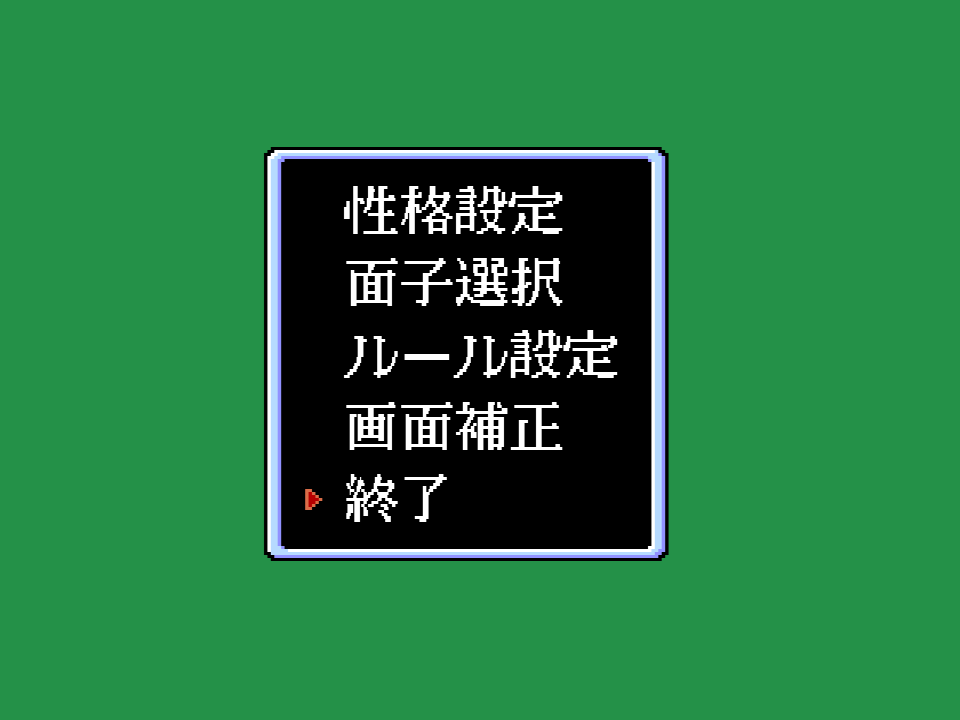 | 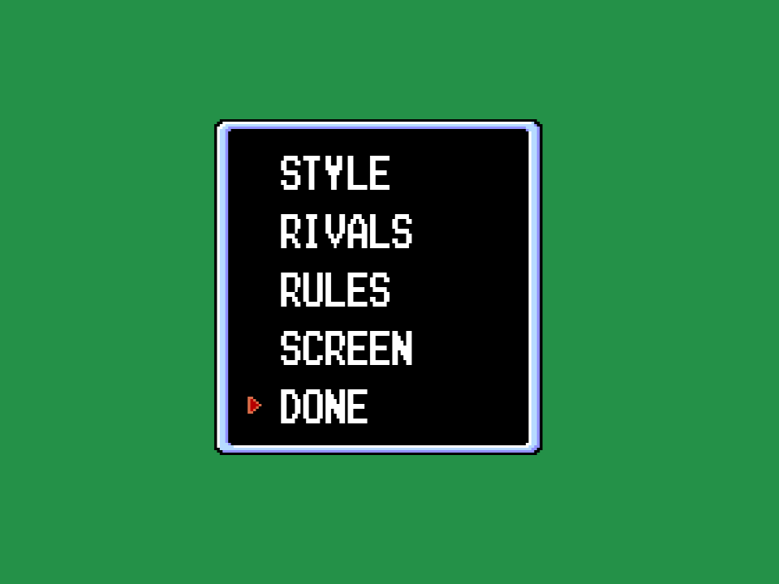 |
| 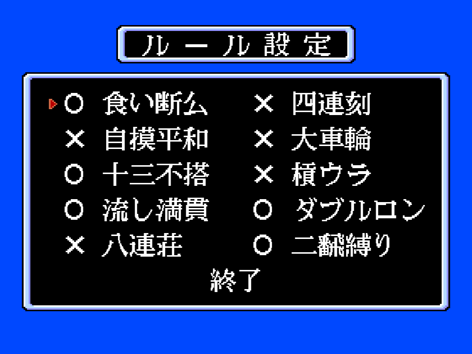 | 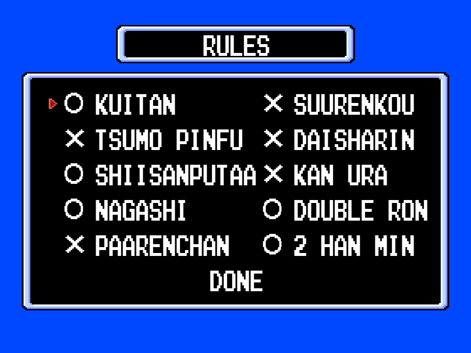 |
| 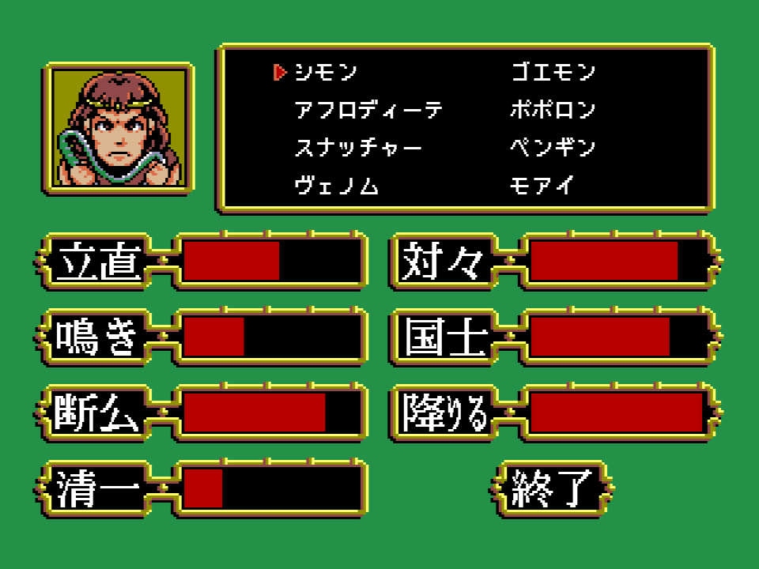 | 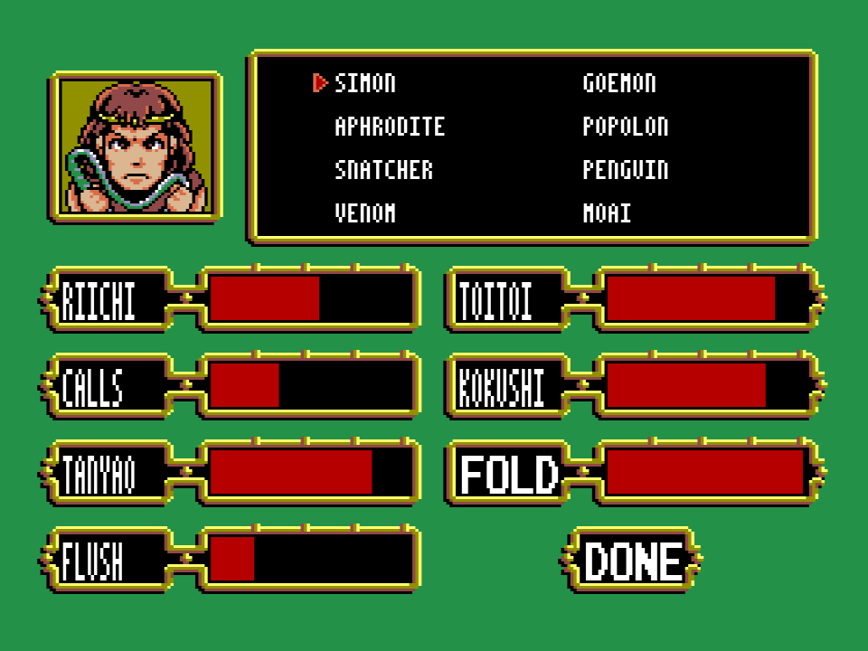 |

| | | |
|---|---|---|
| 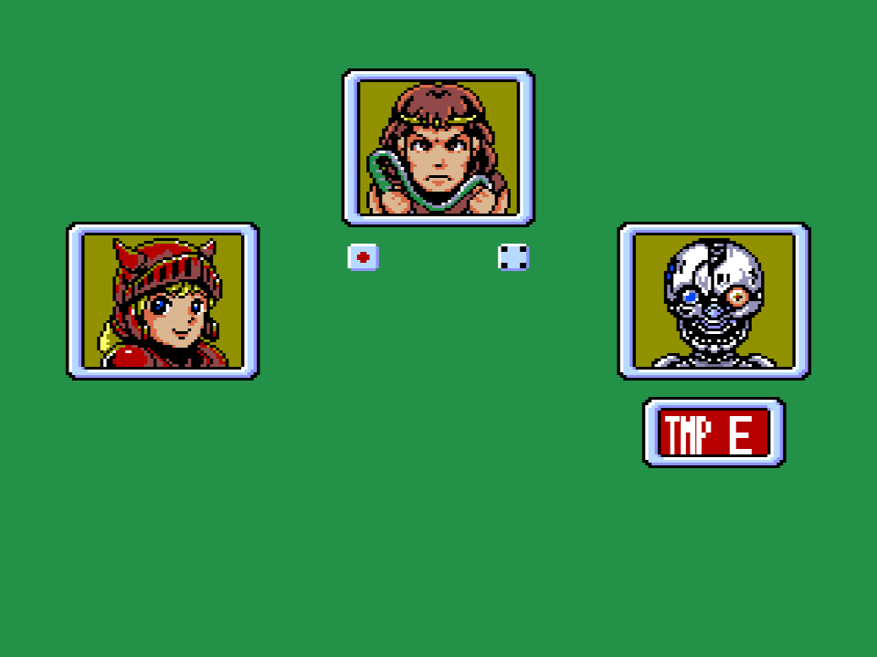 | 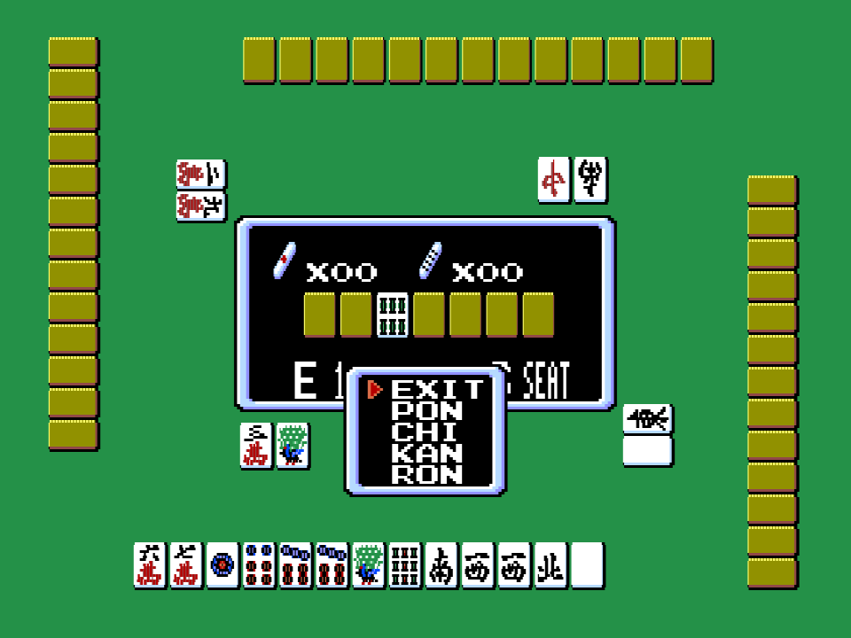 | 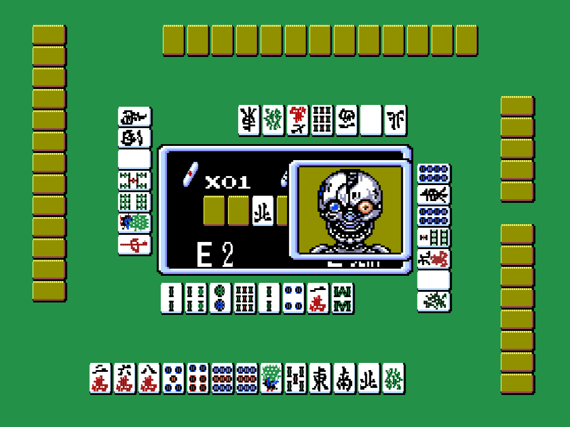 |
| 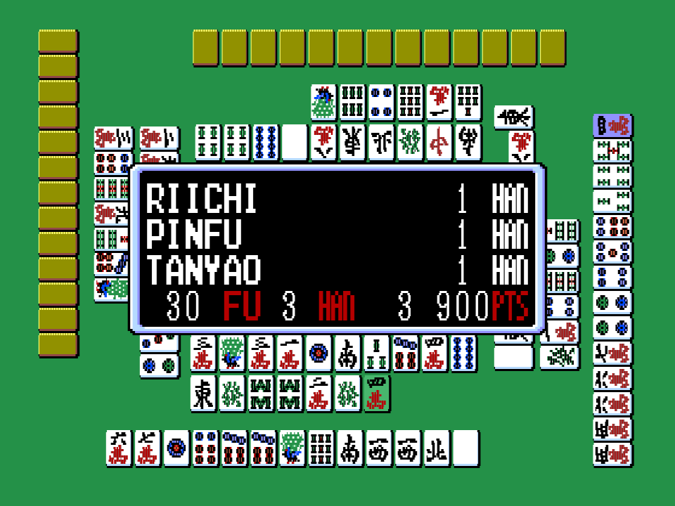 | 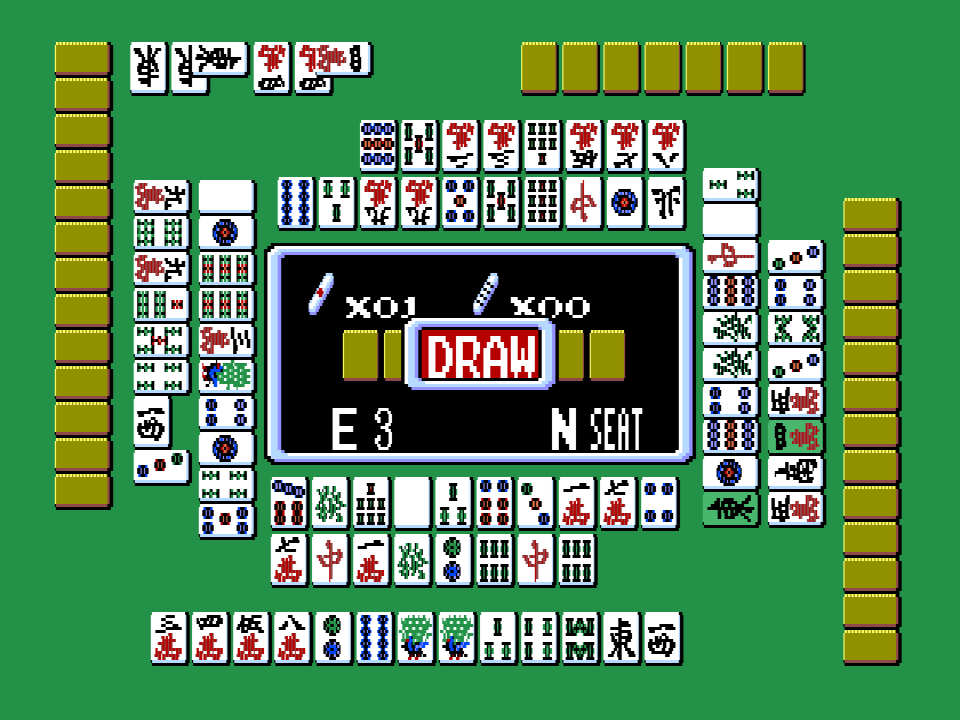 | |

## Cómo se usa

1. En el título, espacio: sale el primer menú (PRACTICE, MATCH).
2. **F1** abre el tutorial; **espacio** pasa de pantalla, y tras la novena vuelve el menú.
3. En PRACTICE, **abajo** en tu turno abre un cuadro con SCORE y OPEN (OPEN enseña las manos de los rivales).

## Qué hace falta

- **La ROM del juego**, que este repositorio no distribuye: *Hai no Majutsushi - Mahjong 2* (Konami, 1989, RC-765), 131.072 bytes, sha256 `7839c843dc787e01765c1ba3efbd26dcf5209d27e38bcee1345db3b3cffdf5db`.
- Cualquier herramienta de IPS (Lunar IPS, Floating IPS, RomPatcher.js). Se aplica [parche/majutsushi_en.ips](parche/majutsushi_en.ips) a la ROM y sale la parcheada, sha256 `334c944a39b3e36eee541c01c7b38b0a6d29704442bd6e24cbae06ee818899ff`.

En openMSX el cartucho necesita su mapper (Konami con DAC):

```
openmsx -machine C-BIOS_MSX2 -cart majutsushi_en.rom -romtype Majutsushi
```

## Cómo se monta

Con Python 3, Pillow y [pasmo](https://pasmo.speccy.org/) en el PATH, y la ROM en la raíz como `majutsushi.rom`:

```
python tools/construye.py majutsushi.rom
```

Ensambla el tutorial ([src/tutorial.asm](src/tutorial.asm)), aplica la traducción de [traduccion/textos_en.txt](traduccion/textos_en.txt) con [tools/traduce.py](tools/traduce.py), comprueba que en cada sitio que escribe está lo que tiene el cartucho original y escribe `work/majutsushi_en.rom` y el IPS. Rechaza cualquier otra ROM. `python -m unittest discover -s tests` pasa los 13 tests. Lo que se midió antes de traducir (cada texto, cómo se dibuja, dónde está, cuánto sitio hay) está en [traduccion/inventario.md](traduccion/inventario.md).

## Cómo funciona

El juego escribe de tres maneras, y cada una se traduce a su manera.

- **Las letras de 16 puntos** (menús, reglas, yaku, puntos; la rutina de p00:5ACD). Cada letra son 32 × 16 puntos de SCREEN 7 en 64 bytes (bancos 5-6), y la fuente tiene 189. La traducción las dibuja de nuevo como **parejas de letras** —el alfabeto Konami de 8 × 8 al doble, dos por casilla de kanji— o tres o cuatro más estrechas donde no hay sitio (las etiquetas de estilo, HAN, PTS). 144 casillas son nuevas; las letras que el código pinta sueltas se redibujan en su sitio: los numerales 一 a 十 de los han pasan a cifras, 東南西北 a E S W N, 家 a SEAT, 飜 a HAN, 点 a PTS. Las cifras y el ○ y el × de las reglas se quedan como están.
- **Las cadenas cambian de sitio.** El inglés pide más bytes que los kanji. Las cadenas de cada banco se colocan de nuevo en el sitio de las viejas y se corrige cada puntero (el `ld hl` de cada llamada, la tabla de yaku de p01:6664, las de límites de p01:6640 y 664E). Los yaku no caben en el banco 1: los que sobran van a los bytes libres del final del banco 4. La rutina de texto pone los bancos 5-6 para cada letra y al volver deja los 1-2-3, así que una cadena del banco 4 solo se leería hasta su primera letra: las tres llamadas que escriben nombres de las tablas (p04:A9B0, AE1E, AA41) pasan antes por una rutina de 36 bytes en p04:BF97 que copia la cadena a la pila y la escribe desde allí. Tres ventanas han pedido cambiar un byte: la pantalla de reglas escribe 12 textos en vez de 16, su segunda columna se mueve seis puntos a la derecha y la primera cuatro a la izquierda para que quepa SHIISANPUTAA, y SCREEN va centrado en su recuadro.
- **Los tiles de 8 × 8** (menús de llamada, nombres; la rutina de listas de p00:5363). La hoja de tiles ya trae el alfabeto latino entero: PON, CHI, KAN, RON, OPEN, HIDE y DRAW se escriben con él. Los 37 tiles de katakana (p07:6138) se dibujan de nuevo como 35 tiles de **dos letras estrechas**, y así los nombres y RIICHI, TSUMO, SCORE y LEFT caben en los mismos bytes que el katakana. Los nombres se cambian en las once listas donde salen (elección de rivales, estilo, resultados y la presentación de la demo).
- **Los rótulos de las llamadas** (p00:58A2) son 16 patrones de sprite por palabra, comprimidos en RLE: letras rojas encima y un contorno oscuro debajo. Los seis se dibujan de nuevo con una letra gruesa inclinada; el sprite del contorno es la silueta entera un punto más gorda (la roja la tapa), que comprime mejor: 1.970 bytes donde los seis viejos ocupaban 2.411.
- **El tutorial** es el de la versión anterior de este parche, con las pantallas de llamadas, riichi/tsumo y menús escritas de nuevo en inglés tal como las enseña ahora el juego (antes apuntaban al katakana y a los kanji). Su gancho en el primer menú es el mismo: los 61 bytes de p00:4396 escritos de nuevo en el mismo sitio, y las pantallas en los bytes libres del final del banco 14 y de p15:AD8B.
- Las direcciones salen del [desensamblado comentado de Hai no Majutsushi](https://antxiko.github.io/Majutsushi-disassembly/).

Lo que queda en japonés: los rótulos de la presentación de la demo (el título y la frase de cada rival), el logotipo, el 麻雀 grande del fondo y las caras de las fichas (萬 y los vientos, como en las fichas de verdad).

## Probado

En openMSX (C-BIOS MSX2), con las capturas hechas con el throttle puesto: el primer menú y el de ajustes, reglas, estilo y elección de rivales, el sorteo de asientos, el recuadro de la ronda, los menús de llamada (con el descarte de un rival, en tu turno, el cuadro de pausa con SCORE, OPEN y LEFT), las listas de yaku con FU, HAN y PTS (los yaku más raros forzados desde el depurador para ver los del banco 4), DRAW, GAME END, NEXT y QUIT, la tabla de resultados, los nombres de la presentación, los rótulos PON! y CHI! y las nueve pantallas del tutorial. Mirado solo en el código y midiendo las ventanas, sin verlo en pantalla: 9 TERMINALS, 4 WINDS, 4 RIICHI, 4 KANS, 3 RON y el menú SAVE del disco. Sin probar todavía en un MSX de verdad.

## Licencia

MIT ([LICENSE](LICENSE)) para el parche, las herramientas y la documentación. El juego es de sus titulares: ver [AVISO-LEGAL.md](AVISO-LEGAL.md).
