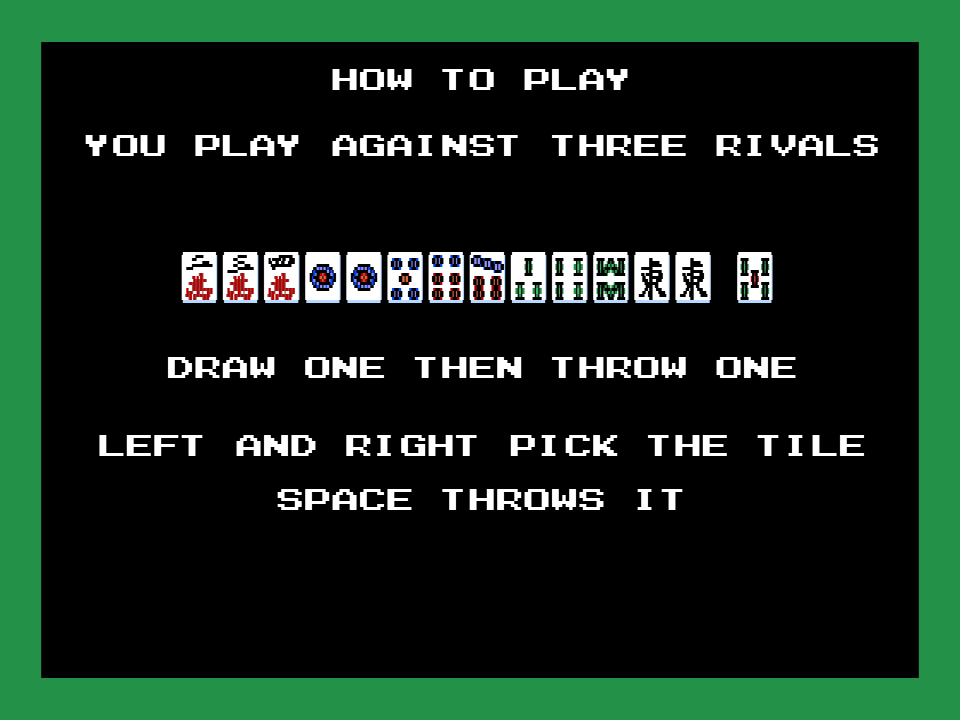
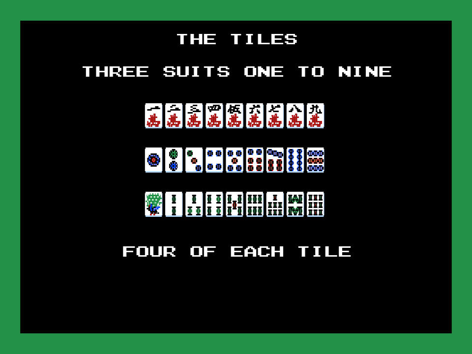
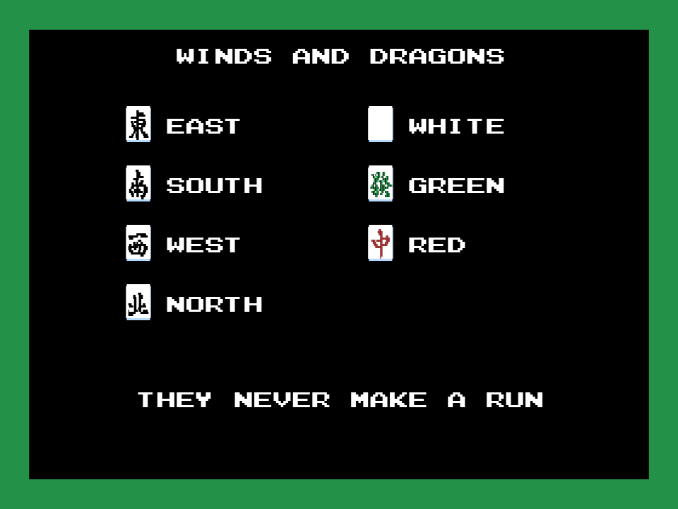
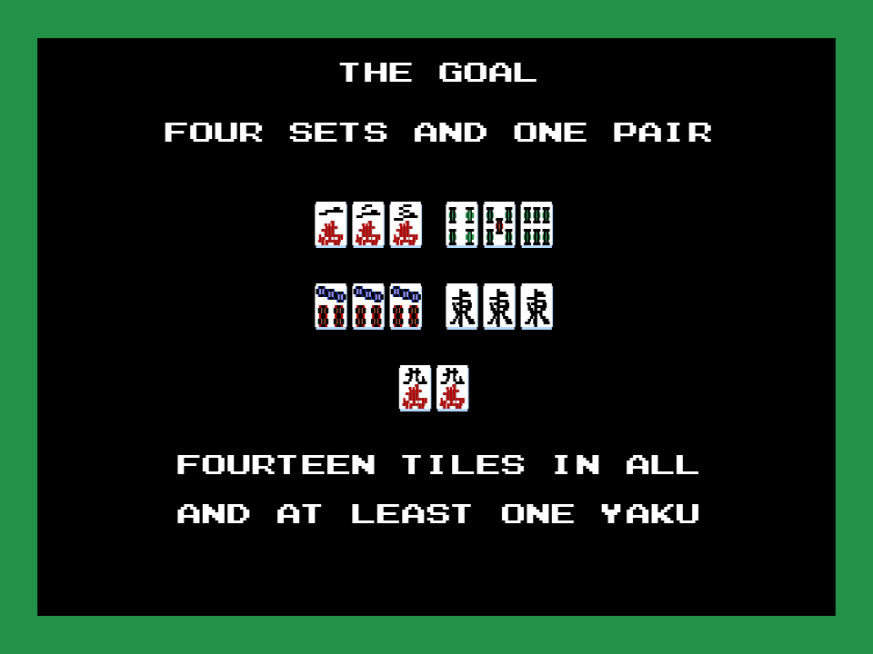
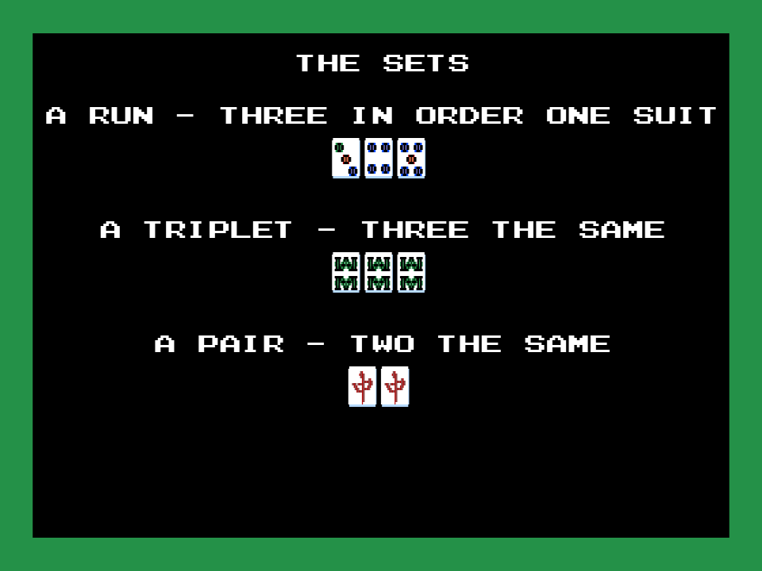
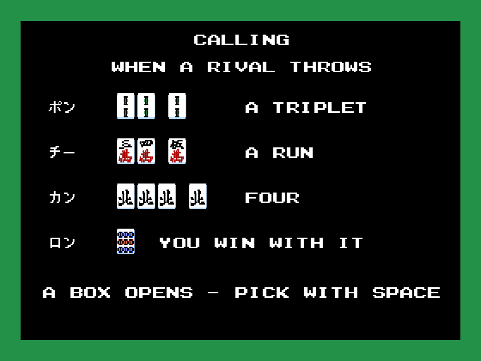
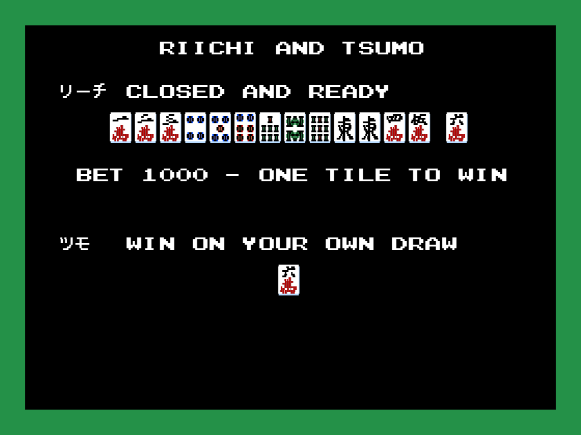
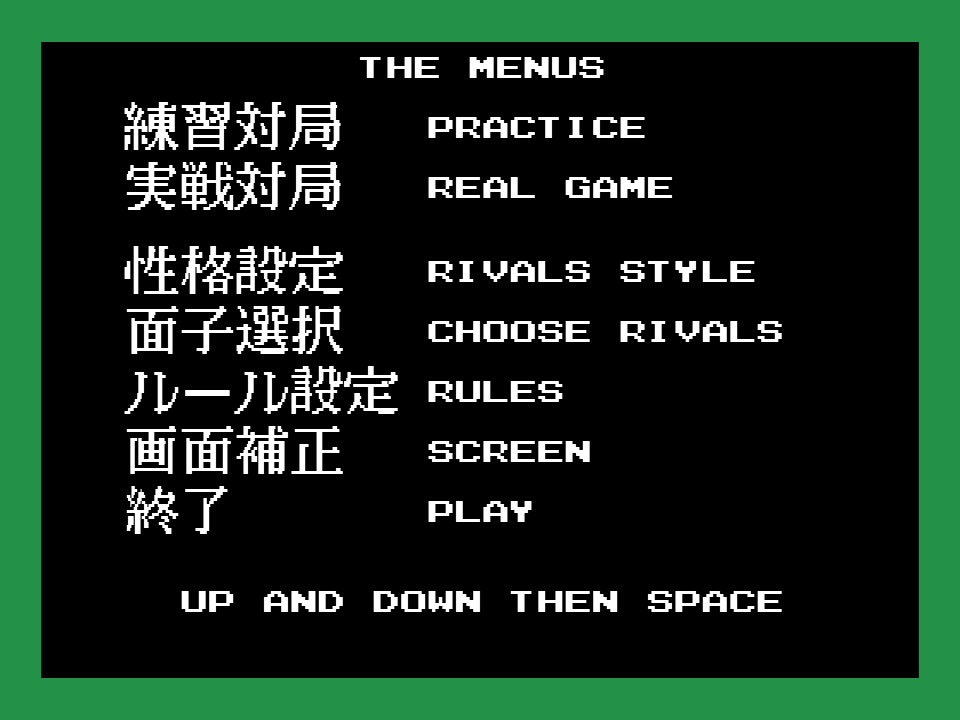
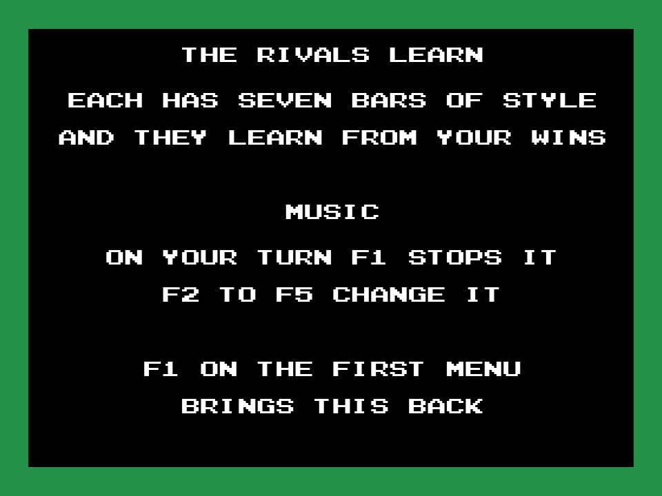

# Hai no Majutsushi — parche tutorial

*[English](README.md)*

牌の魔術師 (*Hai no Majutsushi - Mahjong 2*; Konami, 1989, RC-765) es un mahjong para MSX2 con todos sus menús y mensajes en japonés. Este parche le añade un **tutorial en inglés**, dibujado con las fichas, las letras y los kanji del propio juego: con **F1** en el primer menú, nueve pantallas enseñan las fichas, los vientos y dragones, el objetivo, las combinaciones, las llamadas, el riichi y el tsumo, qué es cada opción de los menús y las teclas de la música. Espacio pasa de pantalla; tras la última se vuelve al menú. El resto del juego no cambia.

**1.313** bytes cambiados en **6** sitios · IPS de **1.351** bytes · todo en espacio que el cartucho no usa · no se distribuye ninguna ROM


## Cómo se usa

1. En el título, espacio: sale el primer menú (練習対局, práctica; 実戦対局, partida de verdad).
2. **F1**. Se abre el tutorial.
3. **Espacio** para la pantalla siguiente. Tras la novena vuelve el menú y el juego sigue como siempre.

| | | |
|---|---|---|
|  |  |  |
|  |  |  |
|  |  |  |

## Qué hace falta

- **La ROM del juego**, que este repositorio no distribuye: *Hai no Majutsushi - Mahjong 2* (Konami, 1989, RC-765), 131.072 bytes, sha256 `7839c843dc787e01765c1ba3efbd26dcf5209d27e38bcee1345db3b3cffdf5db`.
- Cualquier herramienta de IPS (Lunar IPS, Floating IPS, RomPatcher.js). Se aplica [parche/majutsushi_tutorial.ips](parche/majutsushi_tutorial.ips) a la ROM y sale la parcheada, sha256 `340bc57b240a376eafd0467d7b5c8b09c3646966dd7591af70f704553f79a0e7`.

En openMSX el cartucho necesita su mapper (Konami con DAC):

```
openmsx -machine C-BIOS_MSX2 -cart majutsushi_tutorial.rom -romtype Majutsushi
```

## Montarlo

Con Python 3 y [pasmo](https://pasmo.speccy.org/) en el PATH, y la ROM en la raíz como `majutsushi.rom`:

```
python tools/construye.py majutsushi.rom
```

Ensambla [src/tutorial.asm](src/tutorial.asm), comprueba que cada sitio donde escribe tiene lo que tiene el cartucho original (o 0xFF donde usa espacio libre) y escribe `work/majutsushi_tutorial.rom` y el IPS. Cualquier otra ROM la rechaza. Las pantallas se escriben en [tools/textos.py](tools/textos.py), que las empaqueta en `src/datos.inc` y no deja pasar ningún renglón ni fila de fichas que no quepa en la pantalla. `python -m unittest discover -s tests` pasa los 7 tests.

## Cómo funciona

- **El gancho.** El primer menú corre a cada cuadro desde p00:4396 (la entrada 1 de la tabla de estados de p00:4313). Ese bloque, con el sonido del cursor y el dibujo del cursor detrás, son 61 bytes. El parche lo escribe de nuevo en los mismos 61 bytes: `bit 4,a` en vez de `ld c,a / and 10h / ld a,c`, y los dos sprites del cursor escritos con `ld l,4` en vez de alternar HL y HL' con `exx`. Así queda sitio para mirar F1 al entrar (el bit 0 de 0xC00C, las teclas de función recién pulsadas) y para el salto al tutorial. El cursor y su sonido se mueven unos bytes, así que se corrigen las tres instrucciones que entran en ellos (p00:436F, 4834 y 483B). Nada más cambia en el banco 0.
- **Todo lo que se ve es del juego.** El tutorial carga primero lo que carga el juego para empezar una mano: la hoja de fichas y su paleta (p00:5746) y las letras y los katakana (p00:5A22), en la página 1 de la memoria de vídeo. Cada ficha (24 × 18 puntos), cada letra (16 × 8) y cada katakana es luego una copia del VDP desde ahí con la rutina del propio cartucho (p00:5151). Los kanji de los menús los escribe la rutina de textos del juego (p00:5ACD) con las cadenas que el cartucho ya tiene en el banco 0 (p00:438C, 4391 y la lista de p00:59F5). Así que el parche no lleva ni una fuente ni un dibujo.
- **La vuelta de las rutinas del juego.** Cargar la mesa y escribir kanji cambian de banco, y acaban con los bancos 1-2-3 puestos, que le quitarían al tutorial el suelo de debajo. El tutorial las llama dejando p00:4246 como su dirección de vuelta: esa rutina vuelve a poner los bancos 13-14-15 y vuelve al tutorial.
- **Empaquetado para que quepa.** El texto va de tres letras en dos bytes (cinco bits cada una, con una tabla de 30 caracteres: las letras, los dígitos y el guion); los katakana y las fichas ocupan un byte cada uno, y los kanji tres. Las nueve pantallas son 961 bytes. Con el código llenan 1.140 de los 1.157 bytes de 0xFF del final del banco 14 (0xBB7B), y el resto del código ocupa 110 de los 117 de p15:AD8B.
- **El espacio libre está medido.** En 15 minutos de openMSX entre título, menús y partida, con un punto de vigilancia en cada lectura de la ROM, nadie lee los 0xFF del final del banco 14 ni los de p15:AD8B.
- Al salir, el tutorial deja el menú en el paso 0, para que se vuelva a dibujar, y repone los bancos 1-2-3, que son los que tiene el menú (medido en openMSX).
- Las direcciones salen del [desensamblado comentado de Hai no Majutsushi](https://antxiko.github.io/Majutsushi-disassembly/es/).

## Probado

En openMSX (C-BIOS MSX2): F1 en el primer menú abre el tutorial, las nueve pantallas pasan con espacio, vuelve el menú, el cursor sube y baja y al elegir práctica y luego 終了 empieza una partida como siempre. Aún sin probar en un MSX de verdad.

## Licencia

MIT ([LICENSE](LICENSE)) para el parche, las herramientas y la documentación. El juego es de sus titulares: ver [AVISO-LEGAL.md](AVISO-LEGAL.md).
