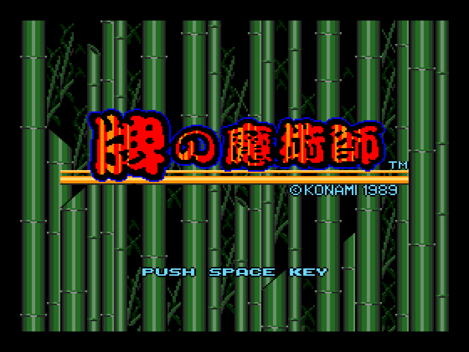
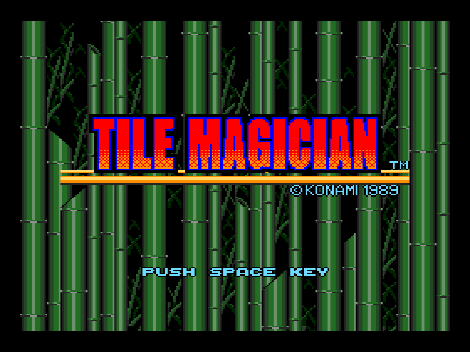
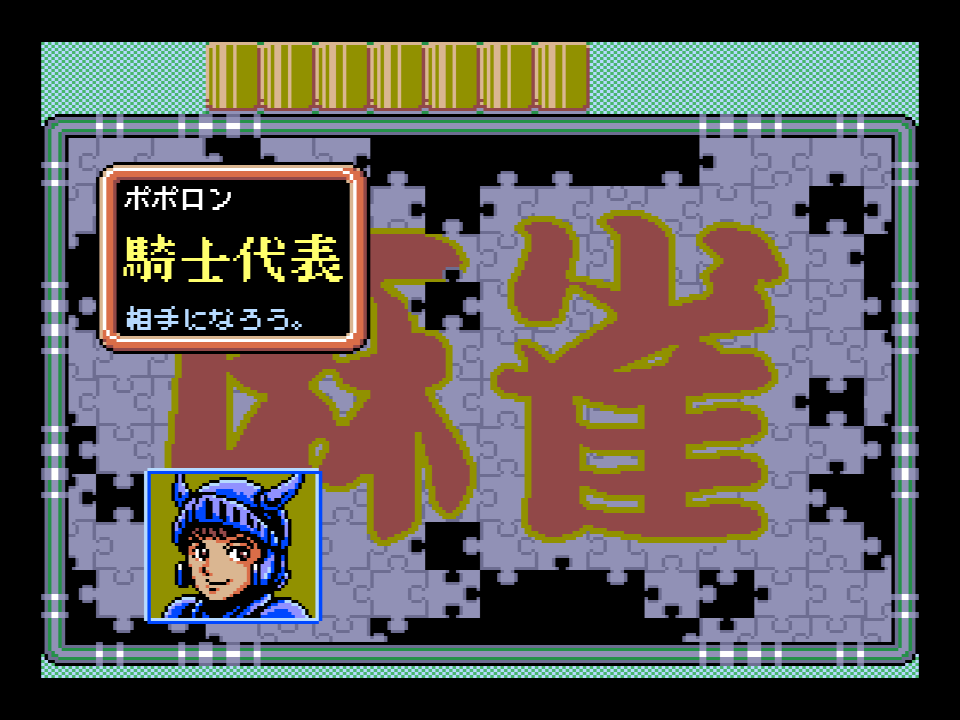
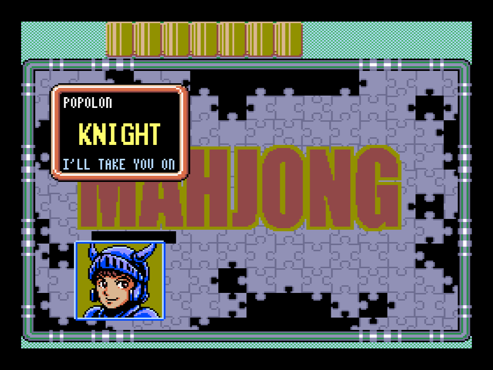
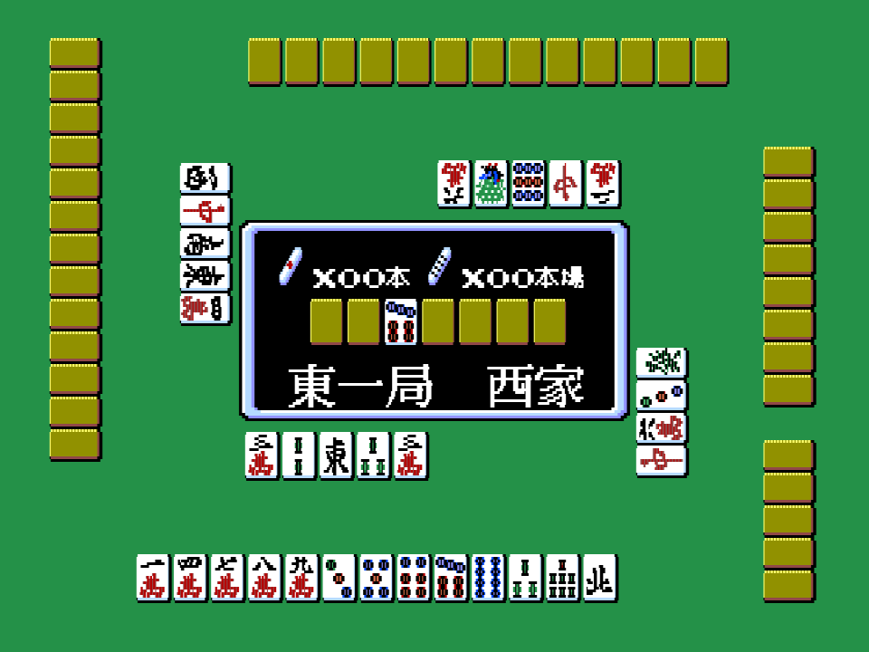
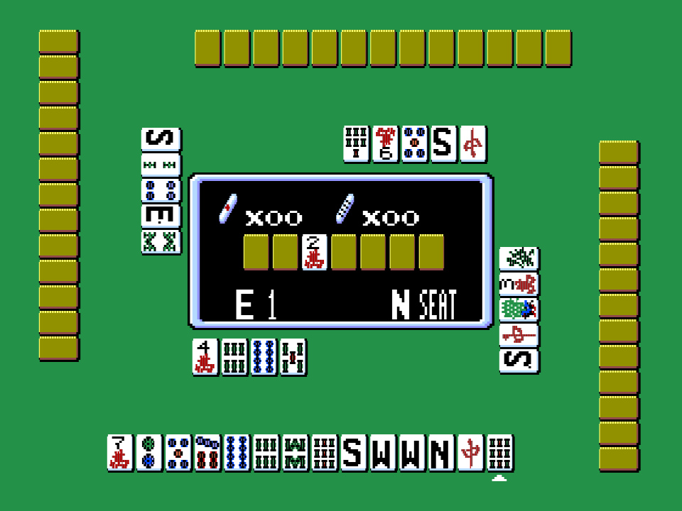

# Hai no Majutsushi — English translation and tutorial

*[Español](README.es.md)*

牌の魔術師 (*Hai no Majutsushi - Mahjong 2*; Konami, 1989, RC-765) is a mahjong game for the MSX2 with all its menus and messages in Japanese. This patch puts **the game in English** — the title logo, the attract introduction (each rival's title and phrase, and the big MAHJONG behind them), the menus, the rules and style screens, the rivals' names, the call menus, the yaku and the scores, the end-of-hand messages, the red PON! / CHI! / KAN! / RON! / TSUMO! / RIICHI! call-outs and the numbers and winds on the tiles — and adds a **tutorial** on **F1** in the first menu: nine screens on the tiles, the goal, the sets, the calls, riichi and tsumo, the menus and the music keys.

**19,652** bytes changed · **22,997**-byte IPS · 144 new letters, 35 new small tiles, 6 new call-outs, a new logo, the introduction redrawn, 13 tile faces in four sizes · no ROM distributed


| Japanese | English |
|---|---|
|  |  |
|  |  |
|  |  |
|  |  |
|  |  |
|  |  |
|  |  |

| | | |
|---|---|---|
|  |  |  |
|  |  | |

## How to use it

1. On the title screen press space: the first menu appears (PRACTICE, MATCH).
2. **F1** opens the tutorial; **space** turns the page, and after the ninth the menu comes back.
3. In PRACTICE, **down** on your turn opens a box with SCORE and OPEN (OPEN shows the rivals' hands).

## What you need

- **The game ROM**, which this repository does not distribute: *Hai no Majutsushi - Mahjong 2* (Konami, 1989, RC-765), 131,072 bytes, sha256 `7839c843dc787e01765c1ba3efbd26dcf5209d27e38bcee1345db3b3cffdf5db`.
- Any IPS tool (Lunar IPS, Floating IPS, RomPatcher.js). Apply [parche/majutsushi_en.ips](parche/majutsushi_en.ips) to the ROM and you get the patched one, sha256 `334c944a39b3e36eee541c01c7b38b0a6d29704442bd6e24cbae06ee818899ff`.

In openMSX the cartridge needs its mapper (Konami with a DAC):

```
openmsx -machine C-BIOS_MSX2 -cart majutsushi_en.rom -romtype Majutsushi
```

## Building it

With Python 3, Pillow and [pasmo](https://pasmo.speccy.org/) in the PATH, and the ROM in the root as `majutsushi.rom`:

```
python tools/construye.py majutsushi.rom
```

It assembles the tutorial ([src/tutorial.asm](src/tutorial.asm)), applies the translation from [traduccion/textos_en.txt](traduccion/textos_en.txt) with [tools/traduce.py](tools/traduce.py), checks that every place it writes holds what the original cartridge has there, and writes `work/majutsushi_en.rom` and the IPS. It refuses any other ROM. `python -m unittest discover -s tests` runs the 15 tests. What was measured before translating (every text, how it is drawn, where it is, how much room there is) is in [traduccion/inventario.md](traduccion/inventario.md).

## How it works

The game writes in three different ways, and each one is translated in its own way; the logo, the introduction and the tiles are pictures, and are drawn again.

- **The 16-dot letters** (menus, rules, yaku, scores; the routine at p00:5ACD). Each letter is 32 × 16 dots of SCREEN 7 in 64 bytes (banks 5-6), and the font has 189 of them. The translation redraws them as **pairs of letters** — the Konami 8 × 8 alphabet at double size, two per kanji cell — or three or four narrower ones where the space is tight (the style labels, HAN, PTS). 144 cells are new; the letters the code draws one by one are redrawn in place: the han numerals 一 to 十 become digits, 東南西北 become E S W N, 家 becomes SEAT, 飜 HAN, 点 PTS. The digits and the ○ and × of the rules screen stay as they are.
- **The strings move.** English needs more bytes than kanji. The strings of each bank are placed again in the room of the old ones and every pointer is corrected (the `ld hl` of each call, the yaku table at p01:6664, the limit tables at p01:6640 and 664E). The yaku do not fit in bank 1: the rest go to the free bytes at the end of bank 4. The text routine puts banks 5-6 in for every letter and leaves banks 1-2-3 when it returns, so a string in bank 4 would only be read up to its first letter: the three calls that write names from the tables (p04:A9B0, AE1E, AA41) go first through a 36-byte routine at p04:BF97 that copies the string onto the stack and writes it from there. Three windows needed a byte changed: the rules screen writes 12 texts instead of 16, its second column moves six dots right and the first four left so SHIISANPUTAA fits, and SCREEN is centred in its box.
- **The 8 × 8 tiles** (call menus, names; the list routine at p00:5363). The tile sheet already has the whole Latin alphabet: PON, CHI, KAN, RON, OPEN, HIDE and DRAW are written with it. The 37 katakana tiles (p07:6138) are redrawn as 35 tiles of **two narrow letters** each, so the names and RIICHI, TSUMO, SCORE and LEFT fit in exactly the same bytes as the katakana. The names change in the eleven lists where they appear (rival choice, style, results and the attract introduction).
- **The call-outs** (p00:58A2) are 16 sprite patterns per word, RLE-compressed: red letters on top and a dark outline below. The six are drawn again with a heavy slanted letter; the outline sprite is the whole shape one dot fatter (the red one covers it), which compresses better: 1,970 bytes where the six old ones took 2,411.
- **The attract introduction** (p04:B479) draws for each rival a list of 8 × 8 tiles: the title ("X代表", two rows of eight tiles) and the phrase, from the picture loaded by p00:56DF. The titles become KNIGHT, THIEF, ISLANDER, VILLAIN, PERVERT, DEMON, S. POLE and WOMAN in 8 × 16 letters (the Konami alphabet at double height) shared by all eight, and the phrases use tiles of two narrow letters; the eight lists are written again where the old ones were and their table is corrected.
- **The title logo** 牌の魔術師 is the tile map p11:A453 with its own tiles, in four groups of fixed palette (1, 2 and 3 bits per dot). TILE MAGICIAN is drawn letter by letter (red fading to orange on the lower half with an ordered dither, blue and black outline: [traduccion/logotipo.txt](traduccion/logotipo.txt)), cut into cells and every cell goes to a group whose palette has its colours: 100 tiles of 122 and the map in 143 of its 162 bytes. The logo is drawn opaque on another page and swept over the bamboo with transparency, so colour 0 shows the bamboo; the ™ stays where it was.
- **The big 麻雀** behind the introduction is baked into the jigsaw-puzzle map p15:AAA0: there is no puzzle under it. The cells of the kanji (and the band of the new text) are filled again with puzzle tiles that already exist, chosen so that every pair of neighbours matches dot by dot at the edge as some pair in the original map does; MAHJONG goes on top ([traduccion/fondo_demo.txt](traduccion/fondo_demo.txt)), 110 tiles. The new map did not fit in its 747 bytes until the filling was allowed to prefer missing pieces (tile 0x00, which compresses in runs) under the text box and the first portrait, where they are never seen: 745 bytes.
- **The tiles.** When a game starts, p00:5746 and 570E build four sets of tile pictures in VRAM page 1 (upright, upside down for the rival opposite, and on their side for the two others), each from its own picture (p08:8151, 81BE, 8225, 82AA) and a layout of 3 × 3 or 5 × 2 half tiles. In each set, the dots where the nine characters tiles differ are the numeral: they are wiped with the blank 白 tile and a digit is drawn, turned like the tile; the winds get E, S, W and N. Some half tiles are shared between tiles, so the glyph looks for the most centred place that only touches half tiles of its own; 203 half tiles redrawn. 萬, 中 and 發 stay, as on real tiles: the tutorial names them.
- **The tutorial** is the one from the earlier version of this patch, with the calls, riichi/tsumo and menus screens rewritten in English as the game now shows them (it used to point at the katakana and the kanji). Its hook in the first menu is the same: 61 bytes of p00:4396 written again in the same space, and the screens in the free bytes at the end of bank 14 and at p15:AD8B.
- The addresses come from the [annotated disassembly of Hai no Majutsushi](https://antxiko.github.io/Majutsushi-disassembly/).

What stays in Japanese: only what is part of the tiles themselves, 萬 under the numbers and the dragons 中 and 發.

## Tested

In openMSX (C-BIOS MSX2), with captures taken with the throttle on: the first and settings menus, rules, style and rival choice, the seat draw, the round box, the call menus (with a rival's discard, on your turn, the pause box with SCORE, OPEN and LEFT), the yaku lists with FU, HAN and PTS (the rarest yaku forced from the debugger to see the ones in bank 4), DRAW, GAME END, NEXT and QUIT, the results table, the title logo, the whole introduction (the eight titles and phrases over MAHJONG), the tiles in the hand, the dora, the discards of all four players, the PON! and CHI! call-outs and the nine tutorial screens. Checked only in the code and by measuring the windows, not seen on screen: 9 TERMINALS, 4 WINDS, 4 RIICHI, 4 KANS, 3 RON and the disk SAVE menu. Not tested on a real MSX yet.

## Licence

MIT ([LICENSE](LICENSE)) for the patch, the tools and the documentation. The game belongs to its rights holders: see [LEGAL-NOTICE.md](LEGAL-NOTICE.md).
